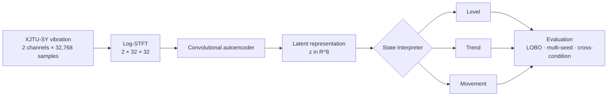
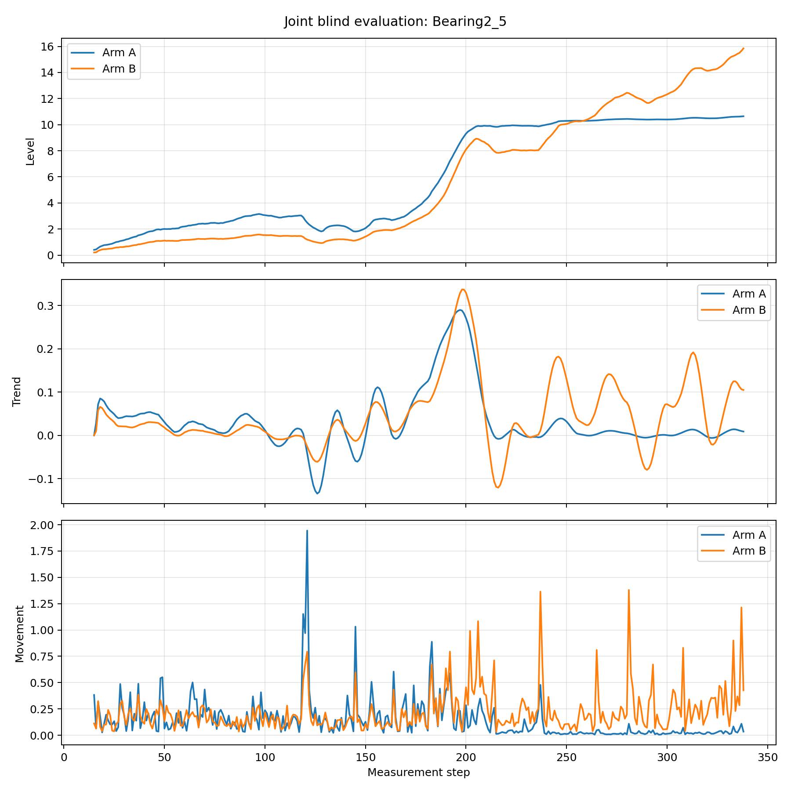
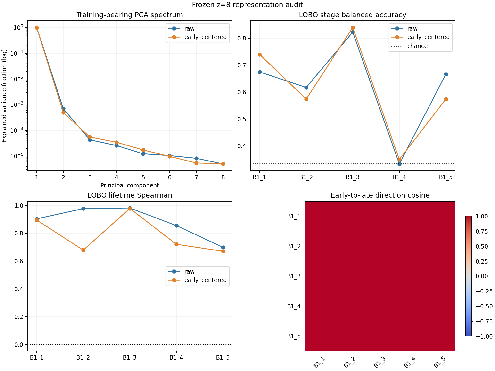
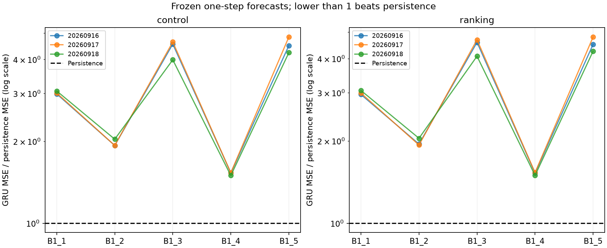
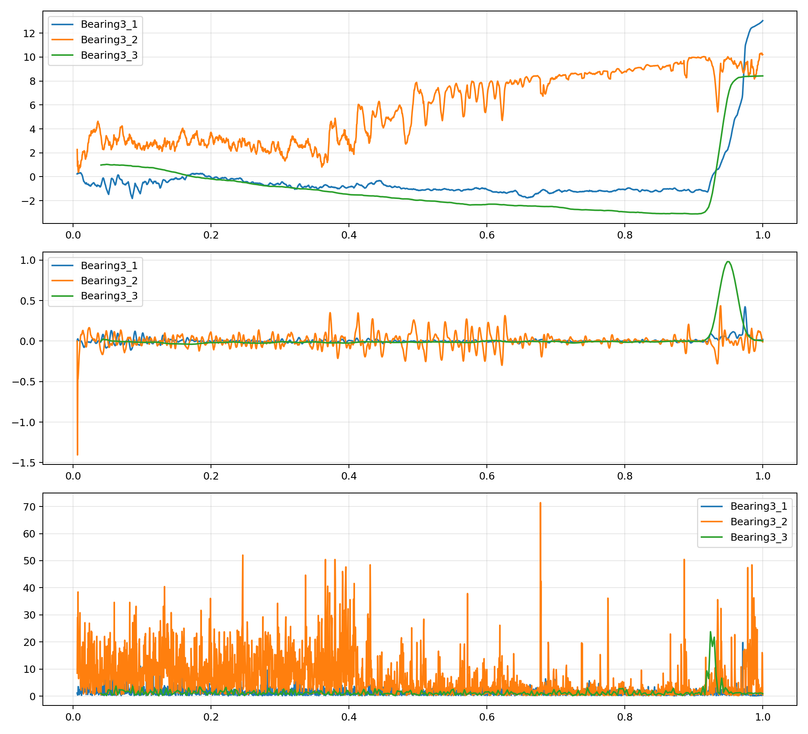

# State Interpreter for Interpretable Machine Condition Analysis

**A reproducible PyTorch research pipeline that transforms vibration signals into causal, interpretable relative machine states.**

`Python` · `PyTorch` · `Signal Processing` · `Autoencoder` · `GRU` · `HMM` · `PHM` · `Model Validation`

[Deutsch](README_DE.md) · [Technical work sample](docs/work_sample/State_Interpreter_Work_Sample_Yuxin_Song_EN.pdf)

## Project overview

Raw vibration is high-dimensional and strongly affected by the machine and operating condition. This project investigates whether a learned embedding can be converted into a state that is continuous, causal and understandable enough for downstream PHM research.

The current output is a **relative state**, not a physical damage percentage or remaining useful life estimate:

- **Level** — deviation from an episode-specific early reference;
- **Trend** — recent causal change of Level;
- **Movement** — short-term change or prediction surprise in latent space.

## Research question

> Can a compact vibration embedding support a reproducible and interpretable relative machine state across random seeds, unseen bearings and operating conditions?

## System pipeline



The encoder and interpreter have separate interfaces. The encoder learns a representation; the interpreter assigns relative temporal meaning. This makes both modules independently replaceable.

## My contributions

- Designed and implemented the preprocessing and state-interpretation pipeline.
- Implemented distance-based, HMM-based and GRU-based state interpreters.
- Built multi-seed, leave-one-bearing-out and cross-condition evaluation workflows.
- Added train-only normalization, split guards, blind-test gates and traceable execution records.
- Audited the latent representation and analyzed domain-shift failure cases instead of reporting only successful runs.

## Data and preprocessing

The experiments use the public **XJTU-SY run-to-failure bearing dataset** with three operating conditions and five bearings per condition. Each measurement contains 1.28 seconds of two-channel vibration sampled at 25.6 kHz.

The default preprocessing is deterministic:

1. Hann-window STFT (`n_fft=1024`, `win_length=1024`, `hop_length=512`);
2. magnitude spectrum and `log1p` compression;
3. adaptive average pooling to `[2, 32, 32]`;
4. channel normalization fitted on training bearings only.

Raw data and large checkpoints are intentionally not stored in this repository.

## Model architecture

`SmallConvAutoEncoder` maps `[batch, 2, 32, 32]` to an eight-dimensional embedding and reconstructs the STFT input. Reconstruction makes the small model easy to train and inspect, but it does **not** guarantee health semantics. The State Interpreter therefore operates as a separate causal layer over ordered embeddings.

## State Interpreter methods

| Method | Input and output | Main finding |
|---|---|---|
| Relative distance baseline | Early calibrated `z` sequence → Level, Trend, Movement | Transparent and strong for relative within-bearing ordering |
| 3-state left-to-right HMM | Distance features → filtered stage probabilities | Smoother, but overconfident and collapsed on one evaluated bearing |
| Predictive GRU | Past embeddings → next-embedding forecast / hidden state | Stable training, but no consistent advantage over the simple baseline |
| Relative State v2 | Signed axis + causal trend + residual-GRU surprise | Separates progression from unexpected movement; semantics remain relative |

## Experimental protocol

- **Bearing-level separation:** train, validation and test bearings are disjoint.
- **Train-only statistics:** test bearings never fit normalization parameters.
- **Multi-seed evaluation:** repeated encoder training quantifies initialization sensitivity.
- **LOBO evaluation:** each bearing is held out in turn.
- **Cross-condition validation:** frozen-source and target-adapted branches are compared.
- **Protected evaluations:** locked configurations, hashes and explicit confirmation gates reduce accidental test reuse.

Normalized lifetime is used only as a post-hoc temporal proxy. It is not a physical damage label and is never the reconstruction training target.

## Verified results

### Multi-seed LOBO stability

Across two operating conditions, five bearing rotations and three random seeds, the 30-run study produced mean Level–lifetime Spearman `rho = 0.959 ± 0.048` with a descriptive 95% interval `[0.941, 0.977]`. Runs sharing a fold reuse data and are not independent samples.

Evidence: [`study report`](results/2026-09-12_v0_1_stability_study/study_report.json) · [`protocol summary`](results/2026-09-12_v0_1_stability_study/README.md)

### Joint blind evaluation

On the preregistered Bearing2_5 evaluation, the frozen source branch reached `rho = 0.946`, while the target-adapted encoder reached `rho = 0.964` (`delta rho = +0.018`, descriptive only).



Evidence: [`blind-evaluation record`](results/2026-09-12_bearing2_5_blind/README.md) · [`locked configuration`](configs/xjtu_cross_condition_v2_1.json)

### Representation audit

The frozen `z=8` embedding contains a strong shared temporal direction, but stage calibration is weak for Bearing1_4. The representation is effectively close to one-dimensional and does not establish a universal absolute health scale.



Evidence: [`representation audit`](results/2026-09-17_z8_representation_audit/README.md)

### Temporal-model baseline check

A predictive GRU did not beat a one-step persistence baseline in any of the 30 fixed seed/bearing/arm comparisons. This prevented an unjustified increase in model complexity.



Evidence: [`comparison report`](results/2026-09-16_gru_persistence_comparison/README.md)

## Failure case: operating-condition shift

The frozen pipeline did not transfer consistently to the third operating condition. Development correlations on Bearing3_1–Bearing3_3 were `-0.391`, `+0.894` and `-0.564`. Reconstruction-based encoder adaptation did not reliably repair the direction instability.



Evidence: [`Condition 3 diagnostic`](results/2026-09-18_condition3_frozen_development/README.md)

This failure is part of the project result: strong within-bearing ordering under two conditions does not imply a condition-invariant health axis.

## What the results do—and do not—show

Supported by the current evidence:

- compact embeddings can support strong relative temporal ordering;
- a simple calibrated baseline is competitive with more complex temporal models;
- the evaluation pipeline detects instability and domain shift.

Not established:

- calibrated physical damage, fault severity or RUL;
- statistical superiority of the adapted encoder from one blind bearing;
- broad generalization to arbitrary machines or operating conditions;
- maintenance or reinforcement-learning utility.

## Repository structure

```text
configs/                 locked and exploratory experiment configurations
docs/                    architecture, methodology and research documentation
examples/                small data-free demonstrations
records/                 execution state separated from experiment configs
results/                 selected reports, tables and figures
scripts/                 training, evaluation, preflight and diagnostic tools
src/state_interpreter/   reusable Python package
tests/                   unit, protocol and leakage-guard tests
```

See the [experiment index](docs/experiment_index.md) for a research-question-oriented map of the main runs.

## Quick start

The minimal example uses synthetic embeddings only. It does not download data and does not represent an experimental result.

```bash
git clone https://github.com/yuxinsong2001/state-interpreter.git
cd state-interpreter
python -m venv .venv
# Activate the environment for your shell, then:
python -m pip install -e .[dev]
python examples/minimal_interpreter_demo.py
python -m pytest -q
```

Expected demo behavior: five calibration updates produce no formal state; later updates print deterministic `Level`, `Trend` and `Movement` values.

## Reproducibility

The public repository supports package tests and the synthetic minimal example without the XJTU-SY dataset. Full historical experiment reproduction additionally requires the public dataset and local checkpoints whose hashes are recorded but whose binaries are not committed.

See [reproducibility notes](docs/reproducibility.md) and [methodology](docs/methodology.md). The repository therefore does not claim one-command full reproduction of every archived run.

## Technical work sample

The application-focused project presentation is available as a PDF:

- [State Interpreter — Technical Work Sample](docs/work_sample/State_Interpreter_Work_Sample_Yuxin_Song_EN.pdf)

It presents the verified pipeline, key results, failure case and transfer of the validation methodology to safety-related perception work.

## Current status and next steps

The relative interpreter and validation harness are implemented. The main unresolved problem is domain-stable representation learning. Planned work should remain development-only until a method passes frozen gates; protected test data must not be reused for model selection.

## License and third-party code

The repository contains adaptations from MIT-licensed projects documented in [`THIRD_PARTY_NOTICES.md`](THIRD_PARTY_NOTICES.md) and [`licenses/`](licenses/). A repository-wide license has not yet been selected, so the absence of a top-level license should not be interpreted as permission to reuse the original project code.

## Author

**Yuxin Song**
M.Sc. Autonomous Systems, University of Stuttgart
[GitHub](https://github.com/yuxinsong2001) · `st196624@stud.uni-stuttgart.de`
