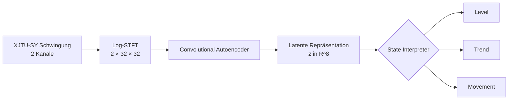

# State Interpreter für interpretierbare Maschinenzustandsanalyse

**Eine reproduzierbare PyTorch-Forschungspipeline, die Schwingungssignale in kausale, interpretierbare relative Maschinenzustände überführt.**

`Python` · `PyTorch` · `Signalverarbeitung` · `Autoencoder` · `GRU` · `HMM` · `PHM` · `Modellvalidierung`

[English](README.md) · [Technical Work Sample](docs/work_sample/State_Interpreter_Work_Sample_Yuxin_Song_EN.pdf)

## Überblick

Das Projekt untersucht, wie niedrigdimensionale Repräsentationen aus Schwingungsdaten in einen kontinuierlichen und nachvollziehbaren Maschinenzustand übersetzt werden können. Die aktuelle Ausgabe ist ein **relativer Zustand** und weder ein physikalischer Schadenswert noch eine Restlebensdauer-Schätzung.

- **Level:** Abstand zu einer frühen, episodespezifischen Referenz;
- **Trend:** kausale kurzfristige Änderung des Levels;
- **Movement:** kurzfristige Bewegung oder Vorhersageabweichung im latenten Raum.

## Pipeline



## Verifizierte Ergebnisse

- **Stabilitätsstudie:** 30 Autoencoder-Trainings über zwei Betriebsbedingungen, fünf LOBO-Folds und drei Seeds; mittlere Level-Zeit-Korrelation `ρ = 0.959 ± 0.048`, 95%-Konfidenzintervall `[0.941, 0.977]`.
- **Einmalige Blindbewertung auf Bearing2_5:** direkte Übertragung `ρ = 0.946`, angepasster Encoder `ρ = 0.964`, Differenz `+0.018`.
- **GRU gegen Persistence:** In 30 festen Vergleichen war der Skill gegenüber der Persistence-Baseline negativ. Die Daten unterstützen daher keinen stabilen Vorteil des GRU.
- **Condition 3:** Die uneinheitlichen Ergebnisse zeigen einen deutlichen Domain Shift; das Ergebnis wird als Generalisierungsgrenze dokumentiert und nicht als erfolgreicher Transfer dargestellt.

Die Korrelation mit der normierten Lebensdauer ist ausschließlich ein Evaluationsproxy. Sie belegt weder einen physikalischen Schaden noch eine RUL-Schätzung.

## Methoden und Reproduzierbarkeit

Die Untersuchungen umfassen distanzbasierte Zustände, explorative HMM-Modelle und GRU-basierte zeitliche Repräsentationen. Festgelegte Splits, trainingsbasierte Normalisierung, Multi-Seed-Auswertungen, Leave-One-Bearing-Out-Versuche und einmalige Blindtests begrenzen Datenleckage und nachträgliche Ergebnisoptimierung.

Weitere Details:

- [Methodik](docs/methodology.md)
- [Architektur](docs/architecture.md)
- [Reproduzierbarkeit](docs/reproducibility.md)
- [Experimentübersicht](docs/experiment_index.md)
- [Technical Work Sample](docs/work_sample/State_Interpreter_Work_Sample_Yuxin_Song_EN.pdf)

## Schnellstart

```powershell
python -m venv .venv
.venv\Scripts\Activate.ps1
python -m pip install -e ".[dev,analysis]"
python -m pytest -q
python examples/minimal_interpreter_demo.py
```

Das Minimalbeispiel verwendet synthetische Embeddings und benötigt weder Rohdaten noch Checkpoints.

## Lizenzhinweis

Für das Gesamtprojekt wurde noch keine Top-Level-Lizenz festgelegt. Drittanbieterkomponenten und deren Lizenzen sind in [THIRD_PARTY_NOTICES.md](THIRD_PARTY_NOTICES.md) dokumentiert. Ohne eine Projektlizenz sind Nutzung, Veränderung und Weitergabe des übrigen Codes nicht automatisch erlaubt.

## Autor

**Yuxin Song**
M.Sc. Autonomous Systems, Universität Stuttgart
[GitHub](https://github.com/yuxinsong2001) · [E-Mail](mailto:yuxin.song@stud.uni-stuttgart.de)
