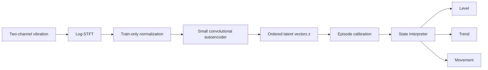

# Architecture

## Purpose

The repository separates vibration representation learning from state interpretation. This allows encoders and interpreters to be evaluated independently and avoids coupling downstream state semantics to one encoder implementation.

## Data contract

| Boundary | Shape | Meaning |
|---|---|---|
| Raw recording | `[samples, 2]` | horizontal and vertical vibration channels |
| STFT tensor | `[2, 32, 32]` | pooled log-magnitude time-frequency representation |
| Encoder input | `[batch, 2, 32, 32]` | normalized STFT batch |
| Latent output | `[batch, embedding_dim]` | compact representation; first baseline uses `embedding_dim=8` |
| Interpreter input | chronological `[embedding_dim]` updates | one bearing/episode at a time |
| Interpreter output | `[Level, Trend, Movement]` | relative causal state components |

## Core modules

- `src/state_interpreter/preprocessing/stft.py`: deterministic log-STFT.
- `src/state_interpreter/encoders/autoencoder.py`: small convolutional autoencoder.
- `src/state_interpreter/relative_temporal.py`: calibrated distance baseline.
- `src/state_interpreter/hmm_temporal.py`: left-to-right Gaussian HMM.
- `src/state_interpreter/gru_temporal.py`: causal predictive GRU.
- `src/state_interpreter/relative_state_v2.py`: signed Level, causal Trend and residual-based Movement.
- `src/state_interpreter/experiment_config.py`: split, access and execution guards.

## Lifecycle

`RelativeTemporalStateInterpreter` has two phases:

1. `CALIBRATING`: early embeddings build an episode-specific reference; no formal state is emitted.
2. `READY`: every update uses only the current and previous embeddings and emits a state.

The interpreter must be reset before processing a new bearing so that references and temporal histories cannot leak across episodes.

## Interpretation boundary

The architecture supports relative temporal interpretation. It does not convert an embedding into a calibrated damage percentage. Normalized lifetime is used for evaluation only and is not a reconstruction target.

